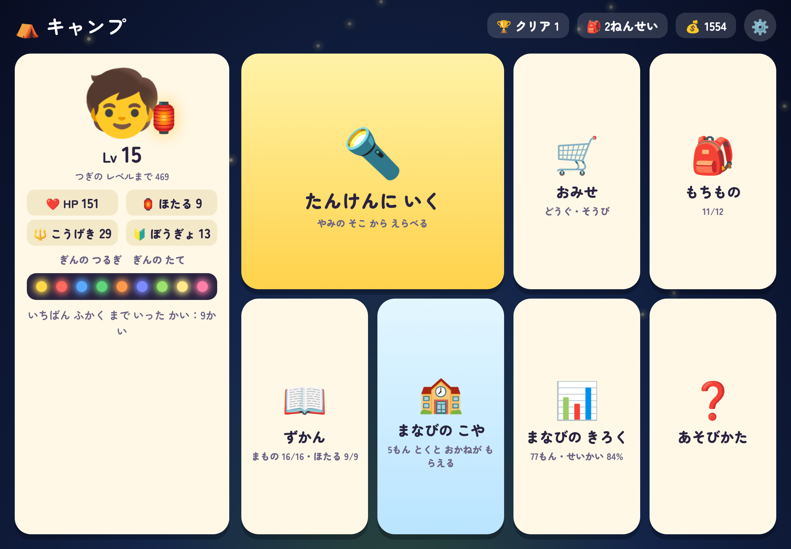
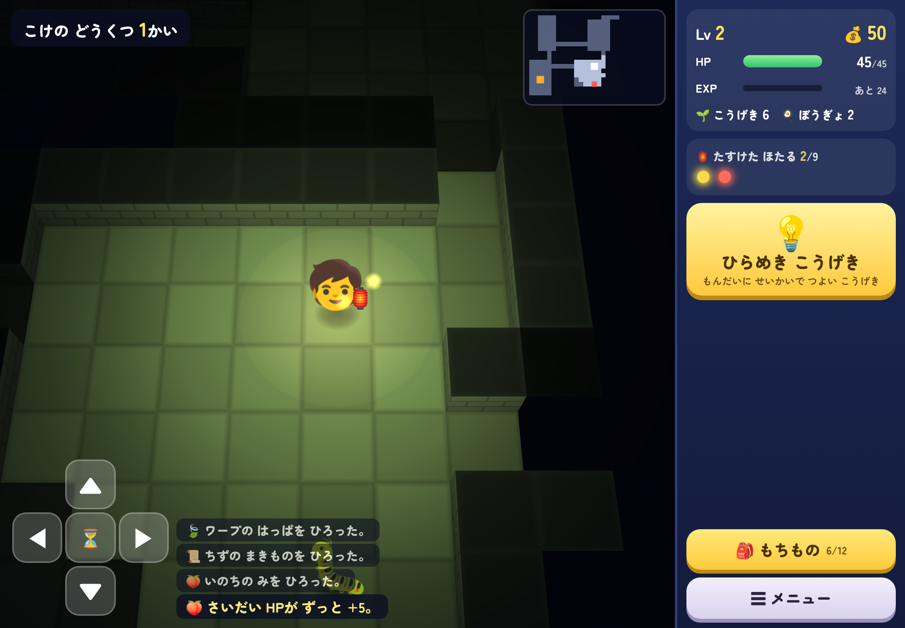
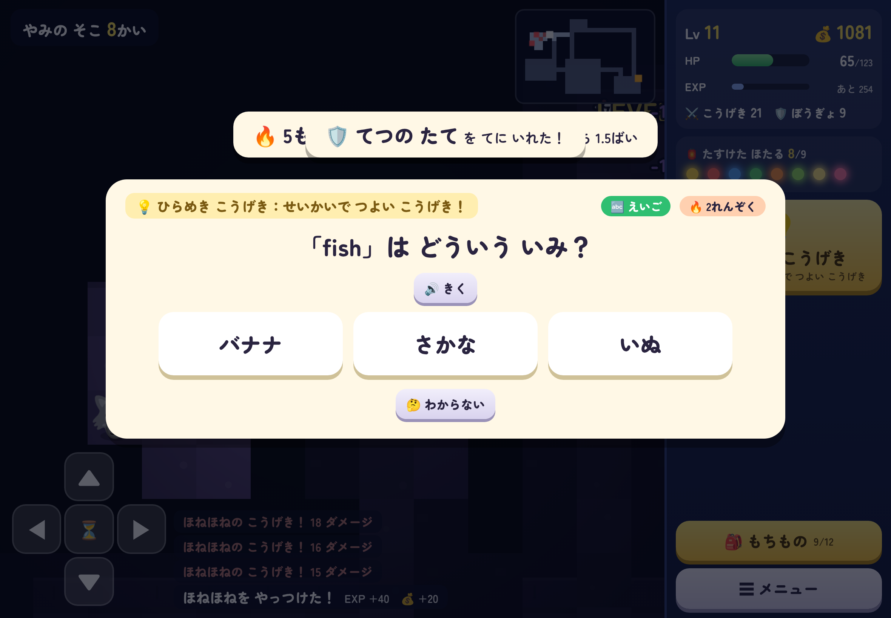
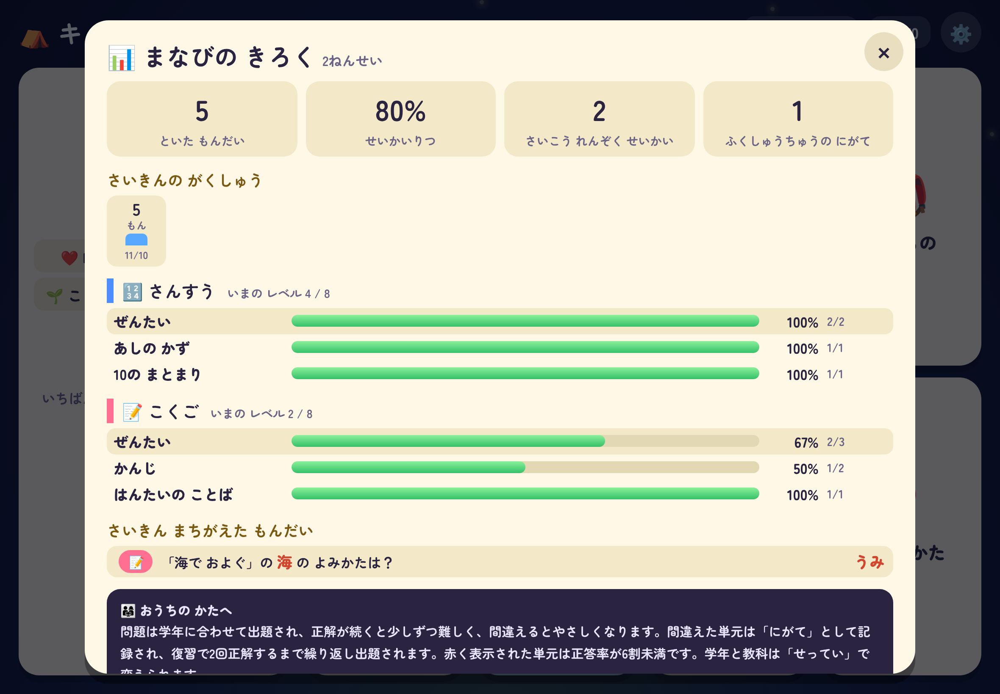

# ほたるの めいきゅう

小学1〜3年生向けの、**学習つきダンジョンRPG**（見下ろし型・入るたびに形が変わる迷宮）。
ランタンを持った主人公が、迷宮に迷いこんだホタルを助けながら、いちばん奥の「やみの ぬし」を目指す。
迷宮は 3D 表示（斜め上から見下ろすカメラ・立体の壁・ランタンの明かり）。「せってい」で 2D 表示にも切り替えられる。
iPad の横画面が基準。スマホも横向きで同じ画面が縮んで表示される。ブラウザだけで動く（インストール・ビルド不要）。

| キャンプ | 迷宮 | 迷宮の中の問題 | まなびの きろく |
|---|---|---|---|
|  |  |  |  |

## 遊びかた

ルールは「歩く・ぶつかって攻撃・道具を拾って使う・階段を下りる」だけ。

- 行きたい場所を**タップ**すると歩く（スワイプ・左下の矢印ボタン・キーボードの矢印でも動ける）
- 魔物に**ぶつかると攻撃**。自分が1回動くと、魔物も1回動く
- 道具（やくそう・ばくだん どんぐり・ねむりの こな・ちずの まきもの など）は 🎒 から使う
- 階段を下りて進む。3階・6階・9階にボス。ボスを倒すと、次からそのエリアの先頭から始められる
- やられてもレベルと持ち物はそのまま。お金が半分になるだけ（直後の復習3問で取り戻せる）
- 途中でやめても、続きから遊べる（自動保存）

## 学習のしくみ

問題は迷宮の進行そのものに組みこんである。1回クリアするまでに 60〜130 問ほど解く。

| 場面 | 問題の出かた |
|---|---|
| 💡 ひらめき こうげき | まっすぐ先に魔物がいるとき、いつでも使える。3択に**正解すると離れた魔物へ強い攻撃**（ふつうの2.5倍）。間違えると空振り |
| 🔑 宝箱 | 正解するまで開かない。**1問目で正解すると中身が良くなる** |
| 🏮 ホタルのかご | **3問正解**すると助けられる（助けるたびに最大HPが増える） |
| 🔁 やられたあと | 復習3問。正解するたびに、落としたお金が3分の1ずつ戻る |
| 🏫 まなびの こや（キャンプ） | 5問1セット。教科を選ぶか、苦手だけを復習できる。正解数に応じてお金がもらえる |

- **正解するたびに経験値がもらえ、迷宮の中ではHPも少し回復する**。5問連続正解ごとに経験値1.5倍
- 間違えたときは、答えと説明を読んでから先へ進む
- **学年**（1〜3年）と**教科**（算数・国語・英語）は最初に選び、「せってい」でいつでも変えられる
- 難しさは自動調整：教科ごとに、2問連続正解で1段階難しく、間違えると1段階やさしく
- 間違えた単元は「にがて」として記録され、**復習で2回正解するまで**ときどき出題される
- **まなびの きろく**（おうちの方向け）：解いた問題数・正答率・教科と単元ごとの正答率（6割未満は赤）・日ごとの問題数・最近間違えた問題と答え
- 文字は「ひらがな／漢字（ふりがな）／漢字」を切り替えられる。英語の読み上げは端末の音声合成

問題の中身（算数・国語・英語の生成、レベル調整）は「かずまほ」「まなびサクセス（仮）」のものを共有している。

## 動かしかた

リポジトリのルートで：

```sh
npx http-server -p 8123 -c-1 .
# → http://localhost:8123/hotaru/
```

GitHub Pages でルートを公開していれば `…/hotaru/` で開ける。Safari の「共有 → ホーム画面に追加」で全画面のアプリになる。

## つくり

依存ライブラリなしの素の JavaScript（ES Modules）。絵は絵文字と canvas／WebGL、音は WebAudio。

```
index.html / css/style.css
js/main.js              タイトル・キャンプ（お店・持ち物・図鑑・まなびの こや・きろく）・設定
js/save.js              保存（localStorage、キーの先頭は hotaru.）
js/data/                魔物・階ごとの出現・道具・装備・ホタル
js/engine/mapgen.js     階の地図づくり（部屋と通路）
js/engine/game.js       探索のルール。act(G, P, 行動) が1ターン進めて、起きたことの並びを返す（画面から独立・Node でも動く）
js/engine/hero.js       主人公の強さ・レベル
js/engine/camp.js       お店のルール
js/engine/learn.js      出題・正誤の記録・苦手の管理（問題の生成は manabi/js/engine/quiz.js を利用）
js/ui/view3d.js         迷宮の描画・3D（WebGL を直接使う。魔物や道具は絵文字の板）
js/ui/view.js           迷宮の描画・2D（canvas。WebGL が使えない端末ではこちらになる）
js/ui/dungeon.js        迷宮の操作と演出
js/ui/quiz.js           問題の画面
共有：../js/text.js（文字切替）・../js/audio.js（音）・../js/util.js・../js/ui/art.js（時計などの図）
```

## テスト

```sh
node hotaru/tools/test_engine.mjs      # 地図（全階×150通りで全部の床がつながるか等）・ひらめき こうげき・宝箱・ホタル・全学年全教科の出題・記録
node hotaru/tools/sim.mjs 100 0.6 0.8  # ロボットが最初からクリアまで遊ぶ（人数・上手さ・問題の正答率）。難しさの調整用
node hotaru/tools/e2e.mjs              # ブラウザでタイトルからクリアまで通す（http-server と Playwright が必要）
```

自動プレイでの目安：クリアまで探検2〜4回。正答率9割ならやられるのは平均0.7回、ひらめき こうげきを使わないと1.6回。

## まだないもの

- 4〜6年生の問題
- スマホ縦持ち専用の画面（今は横向きにする案内が出る）
- GAS 1ファイル版
