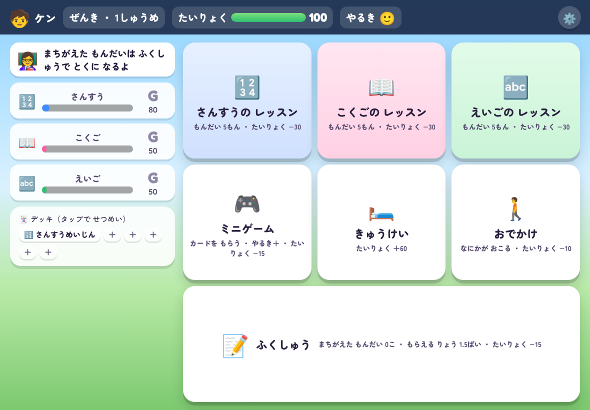
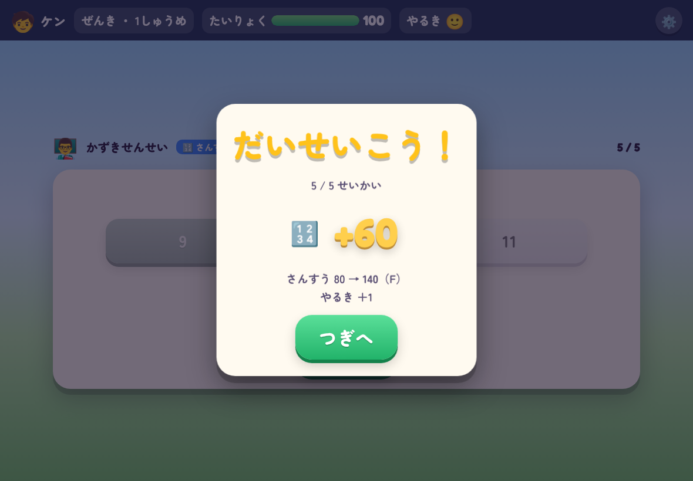
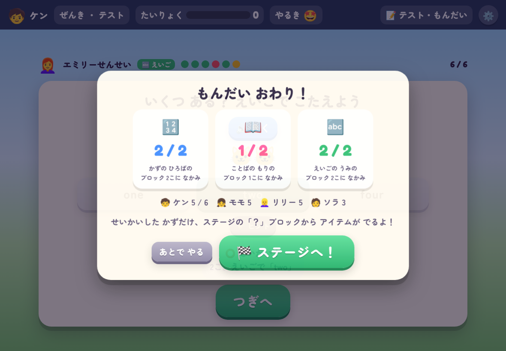
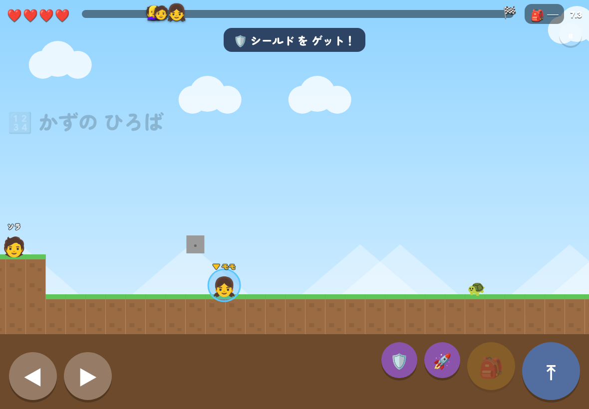
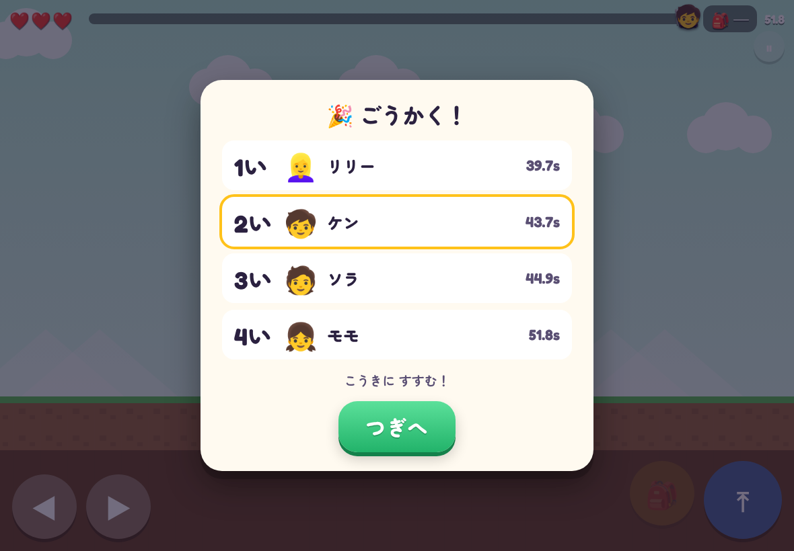

# まなびサクセス（仮）

小学生向けの育成シミュレーション型 学習ゲーム（**試作版**）。
パワプロの「サクセス」と、シャニマスの「WING」を手本に、算数・国語・英語の問題を解いて能力値を上げ、ミニゲームでスキルカードを集め、学期末のテストに挑む。
テストは「問題を6問解く → ライバル3人と同じステージを走るマリオ風の2Dアクション」の2段構え（カードゲーム・RPG は既存作と重なるので、本作の試合はアクション）。

- 1周＝前期・後期（各4週＋テスト）、約15分。後期のテストで1位になればクリア
- テストに落ちると育成終了。ただし能力の一部（引き継ぎポイント）とカード1枚を次の周に引き継げる
- 主人公は4人の候補から選ぶ。選ばなかった3人がライバルになる

要件定義は [`docs/REQUIREMENTS.md`](docs/REQUIREMENTS.md)。

## 画面

| ホーム（週コマンド） | レッスン | テストの問題フェーズ | ステージ | 結果 |
|---|---|---|---|---|
|  |  |  |  |  |

## 動かしかた（WEB版）

リポジトリのルートで：

```sh
npx http-server -p 8123 -c-1 .
# → http://localhost:8123/manabi/
```

GitHub Pages でルートを公開していれば `…/manabi/` で開けます。iPad の横画面が基準です。
文字切替（ひらがな／漢字）・音・算数の問題生成・SVG の部品はルートの `js/` を共有しています。

### ステージの操作

- iPad：左下の ◀▶ で移動、右下の ⤒ でジャンプ（長押しで高く）、🎒 でアイテム。設定で「オートラン」（◀▶なし）にできる
- キーボード：← → / A D で移動、Space / ↑ / W でジャンプ、Z / X / Shift でアイテム
- ？ブロックを下から叩くとアイテム（問題フェーズで正解した数だけ中身が入る）。HP が 0 になるとチェックポイントから3秒後に復活

## 今あるもの（試作版 v0.1）

| 部分 | 状態 |
|---|---|
| はじめかた | 学年 1〜3、主人公4人、引き継ぎポイントの振り分け、持ち込みカード |
| 週コマンド | レッスン（算数・国語・英語、5問）、ミニゲーム（3種）、きゅうけい、おでかけ、ふくしゅう |
| 問題 | 算数はかずまほの生成器を流用。国語（漢字・反対語・カタカナ・仲間はずれ・助詞・文の順番・こそあど）と英語（単語・聞き取り・アルファベット・あいさつ・数）は本作で追加。読み上げは端末の音声合成 |
| スキルカード | アクティブ10（問題用4・ステージ用6）・パッシブ13。デッキ上限5。ミニゲームの成績で3枚から1枚 |
| テスト | 問題フェーズ6問 → ステージ（横スクロール・4人同時・アイテム・HP・チェックポイント・ライバルAI）→ 順位で合否 |
| 記録 | せいせきひょう・アルバム・称号・カードずかん・おうちのひとへ（単元別の正答率と間違えた問題） |
| 未実装 | ミニゲーム「ことば つなぎ」「しんけいすいじゃく」、4〜6年、GAS 1ファイル版、実況の充実、むずかしいモードの細部 |

## GAS 1ファイル版

`node tools/build_gas.mjs` で `gas/manabi.html` ができる（`gas/README.md` の手順で `manabi` という名前の HTML ファイルとして貼り、URL の最後に `?game=manabi` をつける）。まだ GAS 上では未確認。

## テスト

```sh
node manabi/tools/test_stage.mjs   # ステージを40シード×2学期で作り、AI 4人を走らせてゴールできるか・かかる時間を見る
node manabi/tools/e2e.mjs          # ブラウザで タイトル→レッスン→ミニゲーム→テスト→ステージ→結果 まで通す（http-server と Playwright が必要）
```
